# Motorlane — Car Dealership Inventory System

[Public repository](https://github.com/adithya79359/Incubyte-Car-Dealership-Inventory-System-) · [Test report](reports/TEST_REPORT.md) · [Supplied conversation](prompt.md)

## Themes and vehicle photography

Use the light/dark switch on the login page or dashboard. The first visit follows the device theme; a manual choice is remembered in this browser. Both modes retain the Motorlane forest-green palette.

In **Manage inventory → Add vehicle / Edit**, enter an optional direct HTTPS image URL or a local `/cars/filename.jpg` path to display a vehicle photo. A preview appears before saving. Leaving the field empty, choosing **Remove image**, or an image failing to load displays the original Motorlane car illustration. No stock photos are assigned automatically. Images are loaded from their source with no referrer sent; use image links you have permission to display.

The API accepts optional `imageUrl` on create and update and returns it as a URL or `null`. An update that omits `imageUrl` preserves the current image; an empty string or `null` clears it. Existing databases receive the nullable image column automatically on server startup. External image URLs must use HTTPS and must not contain credentials. For local photos, place JPG, JPEG, PNG, WebP, or AVIF files in `public/cars/`, enter their `/cars/filename.jpg` path, and rebuild. File-upload controls are not included. The editor warns when a link fails to load.

Registration and login page with vehicle CRUD, search, and inventory APIs built with React, Tailwind CSS, Node.js, Express, and PostgreSQL. Requires Node.js 24 or newer and a running PostgreSQL server.

## Run locally

Create the application and test databases in PostgreSQL (using psql or pgAdmin):

```sql
CREATE DATABASE motorlane;
CREATE DATABASE motorlane_test;
```

Copy `.env.example` to `.env` and set `DATABASE_URL` and `TEST_DATABASE_URL` with your PostgreSQL username and password. URL-encode special characters in credentials. The server creates its tables and adds the optional image column on startup. Use the port of your PostgreSQL installation; on this machine it is 5433.

```sh
npm install
npm run dev
```

Open the local address printed by Vite (normally http://localhost:5173). The API listens at http://127.0.0.1:3001.

```sh
npm test
npm run build
npm start
```

After building, `npm start` serves the frontend and API together at http://127.0.0.1:3001.

## Authentication

- `POST /api/auth/register`: accepts `name`, `email`, and `password`; returns a user and JWT.
- `POST /api/auth/login`: accepts `email` and `password`; returns a user and JWT.
- `GET /api/auth/me`: accepts an `Authorization: Bearer <token>` header; returns the authenticated user.

Passwords require 12–128 characters and are hashed using scrypt with a unique random salt. Email addresses are normalized and unique. New accounts always receive the `user` role. JWTs expire after one hour. The page keeps its token in memory, so refreshing or signing out clears the browser session. Sign-out does not revoke an already issued token on the server.

Accounts persist in PostgreSQL through the connection specified by `DATABASE_URL`. A random development signing secret is generated in `data/.jwt-secret`. This file and `.env` are ignored by Git. For production, set `NODE_ENV=production` and `JWT_SECRET` to a random secret of at least 32 characters, and serve behind HTTPS. Set `PORT` to change the API port (default 3001; update the Vite proxy too when changing it during development).

Tests require `TEST_DATABASE_URL` pointing to a dedicated PostgreSQL test database. Each test creates a uniquely named schema and drops only that schema afterward; the test user must have permission to create schemas. The suite exercises registration, login, duplicate emails, validation, and JWT protection against a real PostgreSQL database.


## Vehicle APIs (Phases 4–6)

Every endpoint below requires `Authorization: Bearer <token>`. Responses use `{ "vehicle": {...} }` for one vehicle and `{ "vehicles": [...] }` for lists. Prices are JSON numbers backed by exact `NUMERIC(12,2)` storage. Lists include zero-stock vehicles and are ordered by ID.

| Method | Endpoint | Access | Purpose |
| --- | --- | --- | --- |
| POST | `/api/vehicles` | Signed in | Create a vehicle |
| GET | `/api/vehicles` | Signed in | List vehicles; accepts the same filters as search |
| GET | `/api/vehicles/:id` | Signed in | Get a vehicle |
| PUT | `/api/vehicles/:id` | Signed in | Replace all five vehicle fields |
| DELETE | `/api/vehicles/:id` | Admin | Delete a vehicle; returns 204 |
| GET | `/api/vehicles/search` | Signed in | Search and filter vehicles |
| POST | `/api/vehicles/:id/purchase` | Signed in | Decrease stock |
| POST | `/api/vehicles/:id/restock` | Admin | Increase stock |

Create and update require these five fields; `imageUrl` is optional:

```json
{
  "make": "Toyota",
  "model": "Camry",
  "category": "Sedan",
  "price": 25000.50,
  "quantity": 2
}
```

Text fields must contain 1–100 characters after trimming. Price must be between 0 and 9999999999.99 with at most two decimal places. Quantity must be an integer from 0 to 2147483647. PUT requires every field, including quantity; it replaces stock with the submitted value. Use purchase/restock for atomic incremental stock changes.

Search example: `/api/vehicles/search?make=toy&model=cam&category=sedan&minPrice=20000&maxPrice=30000`. Make and model use case-insensitive literal substring matching; category uses case-insensitive exact matching. All supplied filters are combined, and price bounds are inclusive. Invalid, repeated, and unknown filters return 400.

Purchase and restock accept `{ "quantity": 1 }`; omitted quantity defaults to one. Each operation checks stock bounds and changes quantity in a single SQL update, preventing overselling and lost increments under concurrent requests. Invalid input returns 400, unauthenticated requests 401, admin-only violations 403, missing vehicles 404, and insufficient stock or stock overflow 409.

New registrations always receive the `user` role. To grant admin access, a trusted database administrator can run the following after the intended account registers (replace the example email):

```sql
UPDATE users SET role = 'admin' WHERE email = 'owner@example.com';
```

Roles are read from PostgreSQL on every authenticated request, so role changes apply immediately to existing tokens. There is no public endpoint for granting admin access.

## Validation

The 12 integration tests cover authentication, vehicle CRUD and validation, combined search filters, authorization, quantity validation, stock overflow, concurrent purchasing, concurrent restocking, and role changes. Run `npm test` with a configured PostgreSQL test database. The frontend production build is checked with `npm run build`.

## Frontend (Phases 7–10)

After registration or login, users enter a responsive vehicle dashboard. Search by make, model, category, and price; use category tabs, price sorting, and the In stock only checkbox. Clear filters to return to the collection. Cards show price in INR and current stock. Purchase opens a quantity confirmation, updates stock through the API, and refreshes results. Sold-out purchases are disabled. This inventory operation does not collect payment.

Administrators also see **Manage inventory**, with add, edit, restock, and delete controls. Deletion requires confirmation. Grant the administrator role using the SQL above, then sign in again to refresh the frontend role. Backend permissions are always checked against the database.

The interface includes loading, empty, success, error, and retry states; keyboard-accessible native dialogs; labelled inputs; and mobile layouts. Vehicle artwork is explicitly labelled as an illustration. JWTs remain in memory and expire after one hour; a 401 response returns the user to login. Refreshing the page clears the session. Sign-out clears the client token but does not revoke issued tokens server-side.

The server sends anti-framing, content-type, referrer, and browser-permission headers. In production it also sends a same-origin Content Security Policy. Serve production over HTTPS. Vehicle create/update endpoints retain the authenticated-user permissions specified in the API brief; their controls appear only in the admin UI. Delete and restock are admin-only on the server.

### Browser integration tests

```sh
npm run test:browser
```

Requires Microsoft Edge and `TEST_DATABASE_URL` in `.env` or the environment. The suite builds the frontend, starts a production-mode test server on port 3101, and uses a separate randomly named PostgreSQL schema with test-only accounts. Six browser tests exercise registration, login, search, purchase, sold-out state, admin CRUD/restock, delete cancellation, mobile layouts, server security headers, network-error recovery, session expiry, and sign-out. Screenshots and failure traces are saved under ignored `test-results/`.

## Screenshots

Captured from the running application with isolated test data; the screenshots do not expose personal accounts. Select an image to open it at full size.

### Login page

[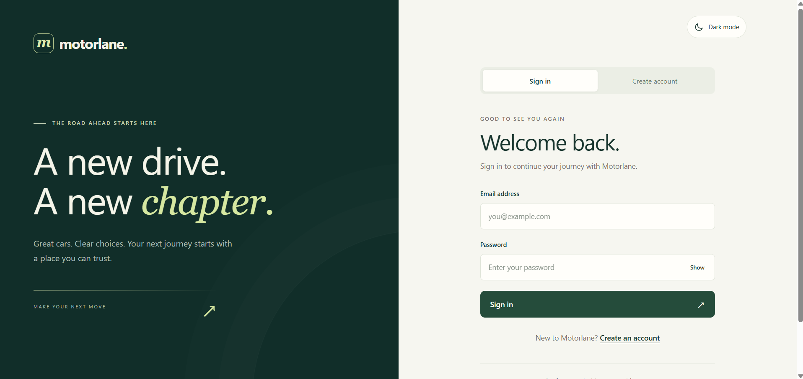](screenshots/login_page.png)

### Customer showroom

[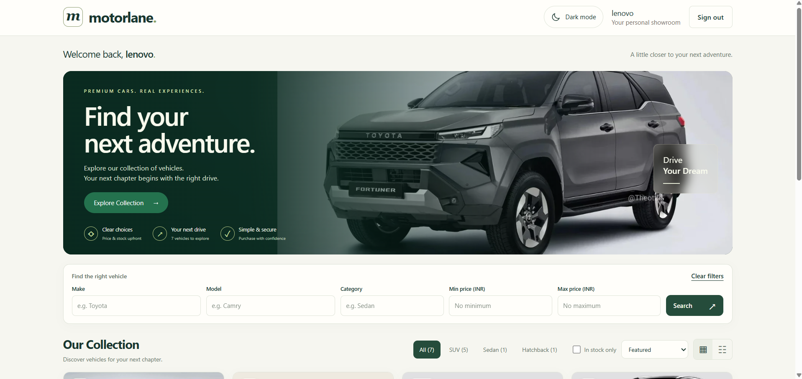](screenshots/user_UI.png)

[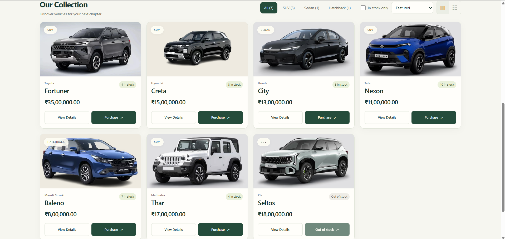](screenshots/User_UI_two.png)

[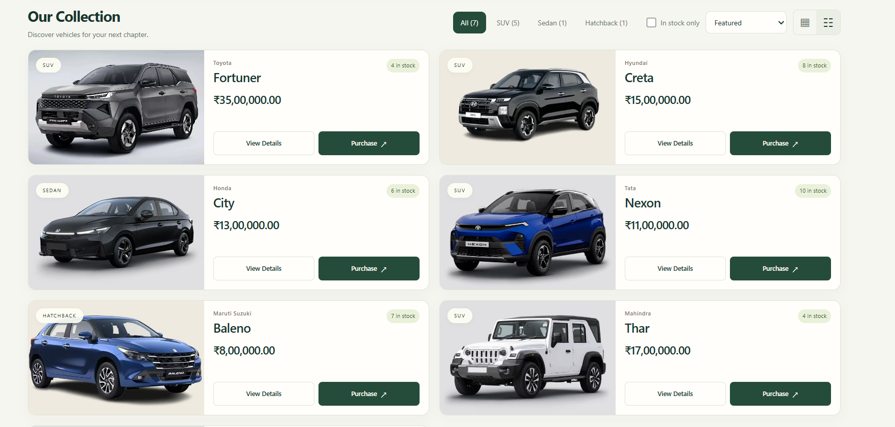](screenshots/expanded_view.png)

### Search and collection controls

[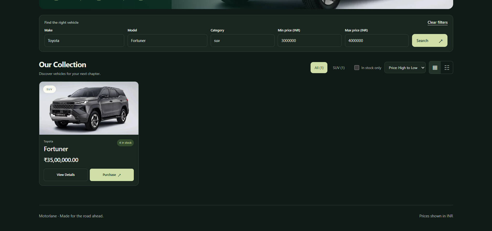](screenshots/serach_filter.png)

[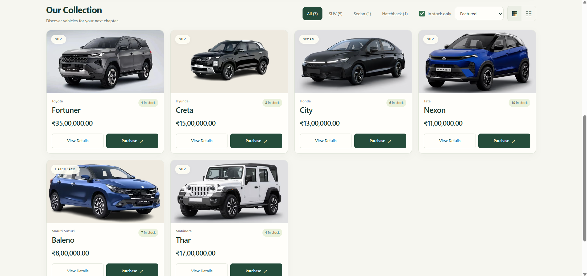](screenshots/in-stock-view.png)

[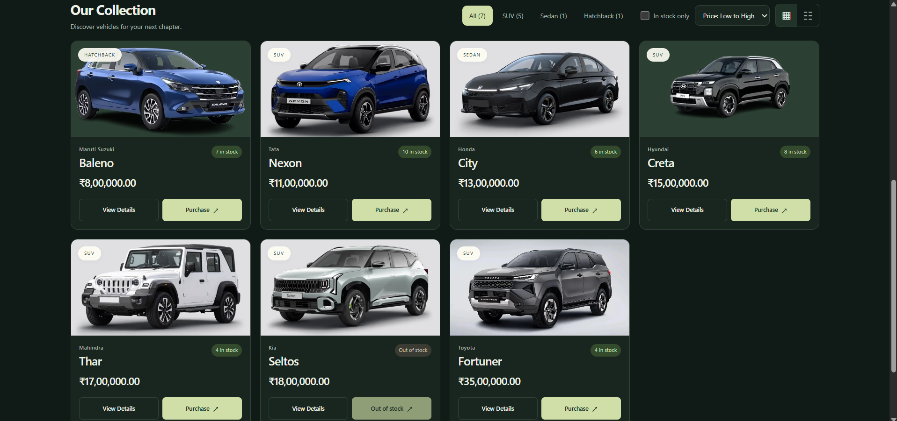](screenshots/price_low-tohigh.png)

[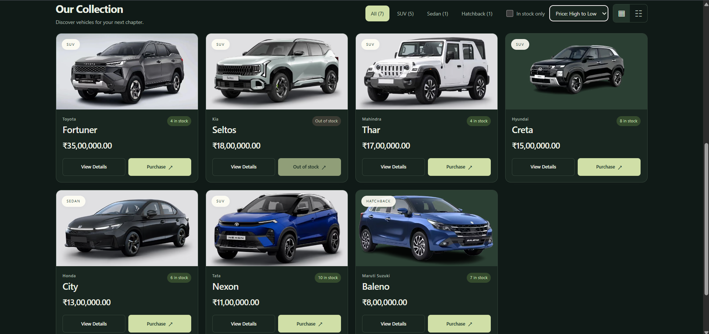](screenshots/price_high-to-low.png)

### Admin inventory

[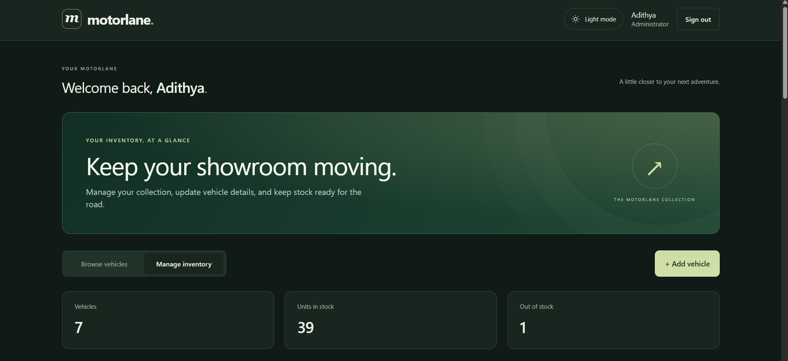](screenshots/admin.png)

[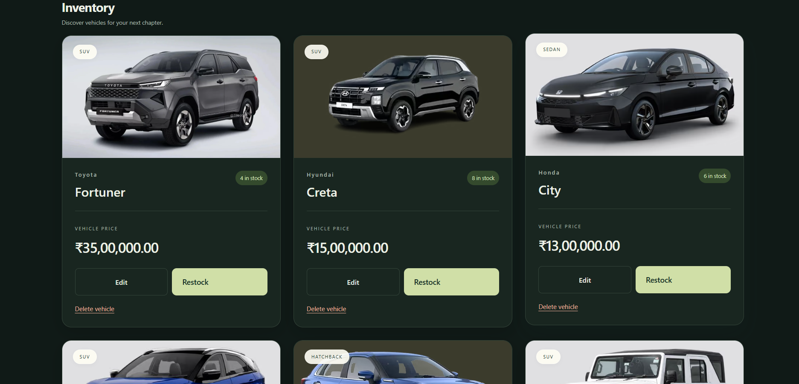](screenshots/admin2.png)

[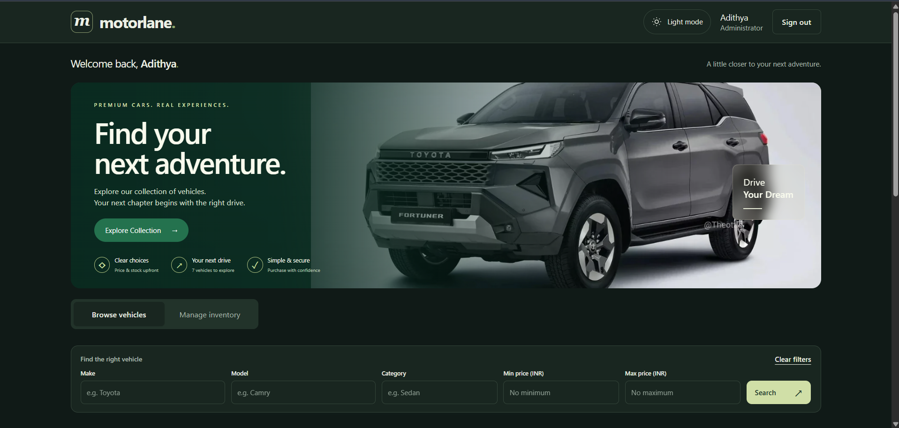](screenshots/admin3.png)

[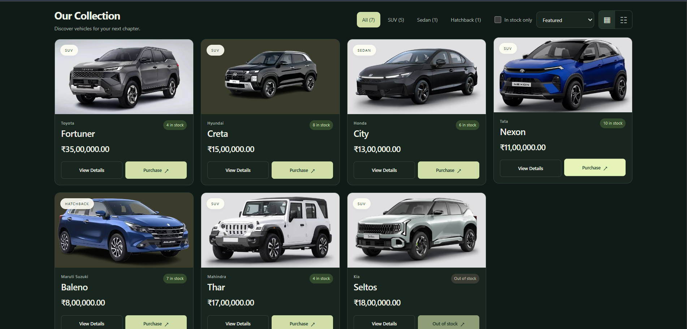](screenshots/admin4.png)

## Contributors and AI assistance

- [Gemini](https://gemini.google.com/) (Google)
- [Claude](https://claude.ai/) (Anthropic)
- [ChatGPT](https://chatgpt.com/) (OpenAI)
- [**ai**Andrey Sitnik](https://github.com/ai)
